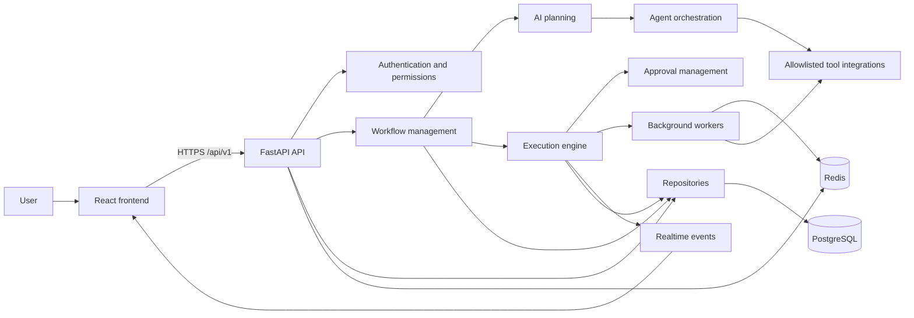

# TaskFlow AI architecture

## Phase 1 boundary

This phase creates the web application and infrastructure foundation only. It does not create workflow records, invoke an LLM, execute tools, schedule jobs, or run agents.

## Component boundaries

| Component | Responsibility | Phase 1 status |
| --- | --- | --- |
| API and authentication | Versioned HTTP interface, request/response validation, identity and authorization | FastAPI app and `/api/v1`; authentication deferred |
| Workflow management | Workflow definitions, revisions, validation, and persistence | Deferred |
| AI planning | Turn user intent into a proposed structured workflow | Deferred; no LLM calls |
| Agent orchestration | Coordinate bounded agent roles and handoffs | Deferred |
| Tool integrations | Allowlisted, typed adapters to external services | Deferred |
| Execution engine | Run validated workflow steps, branches, retries, and cancellation | Deferred; no execution |
| Background workers | Isolate long-running work from API requests | Deferred; queue service boundary reserved |
| Approval management | Store approval requests and enforce sensitive-action gates | Deferred |
| Realtime events | Publish execution and approval state changes to clients | Deferred |
| Data and infrastructure | PostgreSQL persistence and Redis-backed coordination/cache | Services configured; schema deferred |
| Frontend | Browser application, routes, reusable UI, and API access | React/TypeScript foundation |

## Architecture diagram



The diagram describes intended boundaries, not shipped Phase 1 behavior. Phase 1 wires the frontend to the FastAPI service and provides PostgreSQL and Redis services; other boxes are future modules.

## Dependency and safety rules

- The API owns transport concerns; domain services should not depend on FastAPI request objects.
- Workflow definitions and their validation are separate from planning and execution.
- Planner output is data, never executable code. Execution must dispatch only registered tools with validated inputs.
- Approval policy is enforced by the execution boundary before sensitive external side effects.
- Persist user ownership on workflow and execution records; every repository query must scope by authenticated user.
- Background jobs should use stable execution IDs, idempotency controls, bounded retries, timeouts, and cancellation.
- External document and tool output is untrusted input. Keep it separate from system instructions and validate it before use.
- Secrets belong in a managed secret store in deployed environments; `.env` is local-only and ignored by Git.
- Database access should be hidden behind repositories/services, with schema changes introduced through Alembic migrations in a later phase.

## Phase 1 runtime layout

```text
Browser
  └── Nginx (frontend container)
        ├── static React application
        └── /api/* reverse proxy → FastAPI
                                  ├── PostgreSQL readiness probe
                                  └── Redis readiness probe
```
