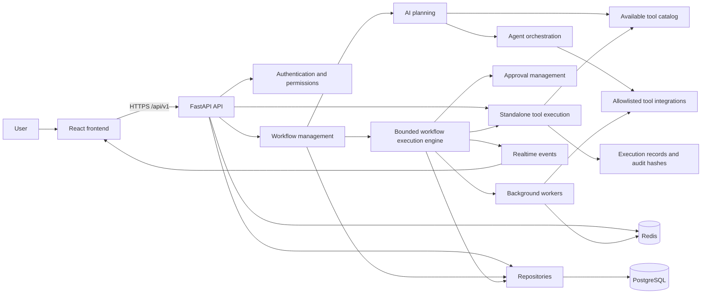

# TaskFlow AI architecture

## Phase boundary

Phase 1 created the web application and infrastructure foundation. Phase 2 added persistence models, migrations, and account/session authentication. Phase 3 added versioned workflow management. Phase 4 added declarative AI-assisted planning. Phase 5 adds a tool registry and standalone safe-tool invocation. Phase 6 adds a persisted, bounded workflow execution engine; scheduling, background workers, realtime events, and external connectors remain deferred.

## Component boundaries

| Component | Responsibility | Implemented status |
| --- | --- | --- |
| API and authentication | Versioned HTTP interface, request/response validation, identity and authorization | FastAPI app, `/api/v1`, Argon2 passwords, JWT access tokens, rotating opaque refresh tokens, and current-user/profile routes |
| Workflow management | Workflow definitions, revisions, validation, and persistence | Authenticated user-scoped CRUD, archive, safe delete, duplicate, publish, and paginated version history |
| AI planning | Turn user intent into a proposed structured workflow | LangGraph intent, planning, validation, dependency analysis, compilation, error handling; drafts are persisted unpublished using available registry tools |
| Agent orchestration | Coordinate bounded agent roles and handoffs | Deferred |
| Tool registry | Define tool contracts, permissions, risk, availability, and bounded execution | Seven safe built-ins, JSON Schema validation, permission checks, async timeouts, result normalization, audit hashes, and per-user execution records |
| Tool integrations | Provide adapters to external services | Email, messaging, CRM, webhooks, external APIs, and document storage are declared as unavailable; adapter protocols are extension points only |
| Execution engine | Run validated workflow steps, branches, retries, and cancellation | Published-version execution with durable step checkpoints, dependency scheduling, restricted conditions, registered-tool dispatch, timeouts, retries, failure branches, cancellation, idempotency, history, and stale-run recovery; runs inline in the API process |
| Background workers | Isolate long-running work from API requests | Deferred; executions are currently bounded to five active minutes per API request |
| Approval management | Store approval requests and enforce sensitive-action gates | Approval steps persist a checkpoint and pause the execution; owners can approve or reject through the API |
| Realtime events | Publish execution and approval state changes to clients | Deferred |
| Data and infrastructure | PostgreSQL persistence and Redis-backed coordination/cache | PostgreSQL schema via Alembic; Redis-backed authentication rate limiting |
| Frontend | Browser application, routes, reusable UI, and API access | React/TypeScript foundation |

## Architecture diagram



The diagram describes intended boundaries, not all shipped behavior. Phases 1–6 provide the frontend, infrastructure, persistence, authentication, workflow management, AI planning, safe tool invocation, and bounded inline workflow execution. Agent orchestration, queued workers, scheduling, realtime events, and external integrations remain future modules.

## Dependency and safety rules

- The API owns transport concerns; domain services should not depend on FastAPI request objects.
- Workflow definitions and their validation are separate from planning and execution.
- Planner output is data, never executable code. Execution must dispatch only registered tools with validated inputs.
- Approval policy is enforced by the execution boundary before sensitive external side effects.
- Persist user ownership on workflow and execution records; every repository query must scope by authenticated user.
- Background jobs should use stable execution IDs, idempotency controls, bounded retries, timeouts, and cancellation.
- External document and tool output is untrusted input. Keep it separate from system instructions and validate it before use.
- Secrets belong in a managed secret store in deployed environments; `.env` is local-only and ignored by Git.
- Production must set an explicit JWT signing secret of at least 32 bytes and enable secure refresh cookies.
- Store only a one-way SHA-256 digest of refresh tokens; refresh tokens are high-entropy random values rotated atomically and revoked per session.
- Access tokens are short-lived and checked against their active database session so logout invalidates outstanding access tokens.
- Authentication rate limits use Redis and fail closed when the limiter is unavailable.
- Workflow versions are snapshots; audit records are append-only and intentionally have no update timestamp.
- Every workflow update creates a new validated version snapshot. Publishing marks the current snapshot immutable; later updates create a new draft version rather than editing a published version.
- Workflow reads and mutations are scoped by the authenticated owner. Executions are constrained to the owning workflow and one of its versions at the database level.
- Workflow deletion is restricted to unpublished workflows with no execution history; archived workflows remain recoverable.
- The planner receives only the runtime registry's available tool metadata and JSON schemas; it cannot dispatch tools or execute workflows.
- LLM output is Pydantic-validated, checked against registry schemas and workflow graph rules, then stored as an unpublished version with its source request and provider provenance for human review.
- Planning providers are configured explicitly (OpenAI or Anthropic); missing credentials fail closed. Mock providers exist only in tests.
- Tool invocation is authenticated, permission-checked, schema-validated, timeout-bounded, and normalized against the registered output schema. Tool execution history and audit logs retain hashes and status metadata, not raw arguments or results.
- Built-in tool permissions are seeded for registered safe tools. External connector metadata is unavailable by default, with no configured adapter or live side effect.
- Workflow execution is allowed only for a published, non-archived workflow and uses the immutable published version even when a newer draft exists. Start, history, detail, approval, and cancellation operations are owner-scoped.
- Execution starts accept an optional owner-scoped idempotency key. Step input/output, attempts, errors, branch outcomes, and approval checkpoints are persisted. Conditions use a restricted reference-and-JSON-literal grammar; no `eval`, generated code, shell execution, or unregistered tool dispatch is available.
- The inline runner caps active execution time at five minutes and registered tool dispatch at 60 seconds. Delay/retry waits refresh execution heartbeats. Startup recovery fails queued/running records stale for 90 seconds, marks an uncertain running step failed, and does not replay it; stale cancelled executions with an in-flight step are reconciled as cancelled without replay. Approval-paused executions remain resumable.
- Cancellation prevents future steps and interrupts delay/retry waits. A tool call already in progress may finish before the runner observes cancellation; future integrations must provide their own idempotency/compensation policy for side effects.
- Document extraction accepts only base64-encoded user-provided UTF-8 TXT, Markdown, CSV, and JSON files, with a 5 MiB decoded limit; no filesystem paths or arbitrary code are accepted.
- `notification.draft` stores an owner-scoped draft only. It does not send email or messaging.
- Database access should be hidden behind repositories/services, with schema changes introduced through Alembic migrations.

## Phase 1 runtime layout

```text
Browser
  └── Nginx (frontend container)
        ├── static React application
        └── /api/* reverse proxy → FastAPI
                                  ├── SQLAlchemy sessions → PostgreSQL
                                  ├── Authentication/session checks → PostgreSQL
                                  └── Rate limits and readiness probe → Redis
```
